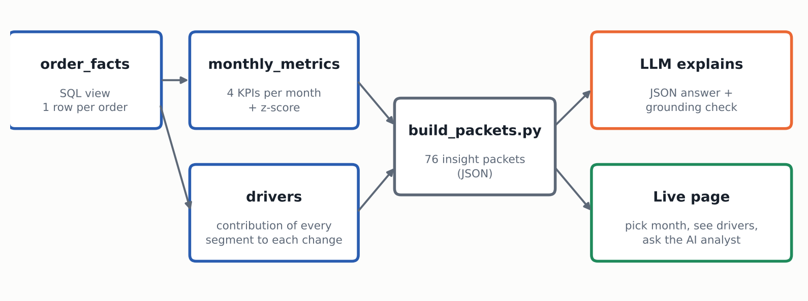
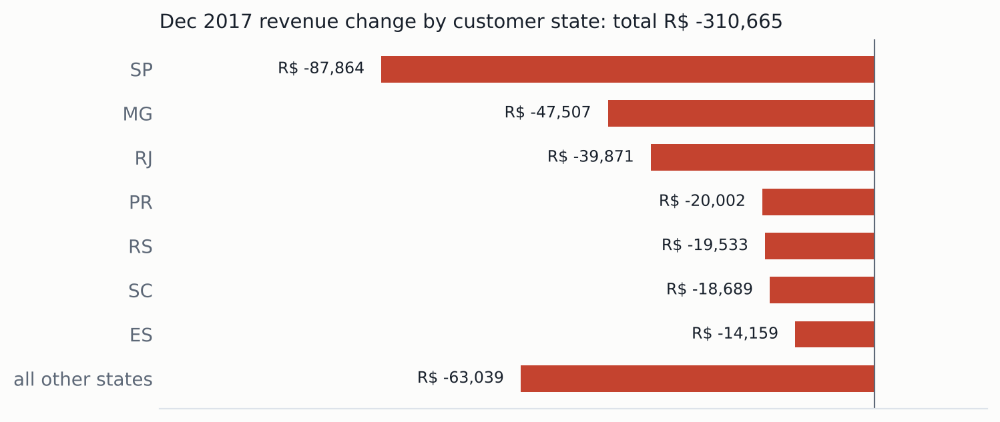
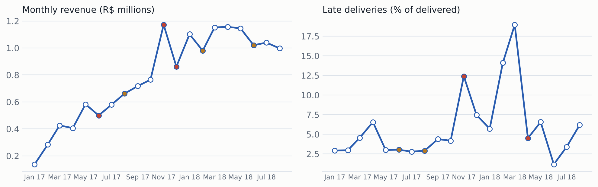

# AI Metric Explainer: why did the metric move?
*by Aarsh Mall*

**Live demo:** https://claude.ai/artifact/9AZ2BguH5qWsBNz9W6JHyh

Dashboards show *that* revenue dropped 26%. Someone then spends a day finding out *why*.
This project automates that work: SQL splits every monthly change into exact contributions by
region, state, product category, seller location, payment type and customer type, flags changes that
are unusual, and an LLM writes the explanation a manager can read. A grounding check verifies that
every number the LLM writes exists in the data.

Built on the **Olist Brazilian e-commerce dataset** (99K orders, Jan 2017 – Aug 2018), using the
PostgreSQL star schema from my [Complaint Cost Engine](https://github.com/mallpraveen811-rgb/complaint-cost-engine) project.

---

## How it works



```
order_facts (SQL view)            one clean row per order
   └─► monthly_metrics (SQL)      revenue, orders, late %, review score + z-score of each change
   └─► drivers (SQL)              exact contribution of every segment to every change
         └─► build_packets.py     one JSON "insight packet" per metric per month (76 packets)
               └─► explain.py     LLM explains the packet → JSON answer → grounding check
               └─► app/           live page: pick a month, see drivers, ask the AI analyst
```

**Key idea: SQL calculates, AI explains.** The LLM never sees the database. It sees only a packet of
numbers SQL already computed, must answer in a fixed JSON shape, and every number in its answer is
checked against the packet.

### The maths (all in `sql/03_drivers.sql`)



| Metric | Segment contribution | Adds up exactly? |
|---|---|---|
| Revenue | segment revenue now − before, split into **volume effect** (more/fewer orders) + **value effect** (bigger/smaller orders) | ✅ |
| Orders | segment orders now − before | ✅ |
| Late deliveries % | (segment late orders ÷ all delivered orders) now − before, in % points | ✅ |
| Avg review score | (segment score total ÷ all reviews) now − before | ✅ |

A change is **unusual** when its z-score against the previous 6 monthly changes is ≥ 2 in size.
A **segment alert** fires when one segment's own move is unusual (|z| ≥ 4) and it explains ≥ 20% of the change,
which catches problems hidden inside a total that looks normal.

---

## Results on the real data

**9 unusual changes found** (out of 76 metric-months):




| Month | Metric | Change | Main drivers (from the explanations) |
|---|---|---|---|
| Nov 2017 | Revenue | +53.28% (z 4.14) | More orders, not bigger ones: volume effect +R$ 483,712; SP customers 36.9% |
| Nov 2017 | Late deliveries | 4.18% → 12.4% (z 5.14) | RJ customers' late rate 6.88% → 26.04% (31.8% of the rise) |
| Nov 2017 | Review score | 4.17 → 3.95 (z −3.94) | RJ customers 4.18 → 3.62 (42.4% of the drop) |
| Dec 2017 | Revenue | −26.5% (z −2.5) | Unwinding of November: bed_bath_table −R$ 47,203 |
| Apr 2018 | Late deliveries | 18.96% → 4.5% (z −3.04) | Recovery led by RJ (34.49% → 4.83%) and SP sellers |
| Apr 2018 | Review score | 3.76 → 4.17 (z 3.83) | Mirrors the delivery recovery |

Full write-ups: [`results/explanations_claude.md`](results/explanations_claude.md). All 9 passed the grounding check.

### Does it find causes we *know* are there? (planted-anomaly test)
`tests/planted_anomalies.py` copies the data, breaks one segment on purpose, re-runs the engine and
checks whether that segment comes out as the #1 driver:

| Planted problem | Found as #1 driver |
|---|---|
| Health & beauty sales collapse (May 2018) | ✅ 81.3% of the change |
| Carrier failure in Bahia (Jul 2018) | ✅ 55.5% |
| Bad batch from Paraná sellers (Jun 2018) | ✅ |
| Same Paraná batch during the Feb 2018 delivery crisis | ❌ ranked #2 behind SP sellers |
| Boleto payment promotion (Sep 2017) | ✅ |
| Watch prices tripled (Mar 2018) | ✅ 65.1% |

**5/6 found.** The miss is informative: a planted shock that's smaller than a real crisis in the same month is outranked by it.
Only 1/6 planted shocks made the *total* look unusual, which shows why per-segment breakdowns matter: segments can break while
the total looks normal.

---

## Analyze your own data (any CSV)

The same analysis works on any file with one row per record and a date column: orders, customers, support tickets, expenses.

**In the browser:** open the live demo → **Analyze your own file** → drop a CSV (or try the Olist / Superstore samples).
The page profiles every column (date, number, category, text; missing values; distinct values), lets you pick the metric
(sum or average of a column, or a row count), the period (month / week / quarter), whether up is good or bad, and up to
6 breakdown columns, then shows unusual periods, the drivers of each change and the AI explanation.
The file is processed in the browser; the AI only receives period totals and top segments.

**From the command line (pandas, no database):**
```bash
python engine/analyze_csv.py samples/superstore_orders.csv --metric Sales
python engine/analyze_csv.py samples/superstore_orders.csv --metric Profit --explain
python engine/analyze_csv.py my_tickets.csv --metric rows --period W --better down
```
`app/engine.js` (browser) and `engine/analyze_csv.py` (Python) implement the same maths; on both samples they produce
identical changes, z-scores and top drivers for every period (checked automatically).

## Run it

Requirements: PostgreSQL with the Olist star schema (run `sql/00`–`sql/04` from the Complaint Cost Engine repo first), Python 3.10+.

```bash
pip install -r requirements.txt
cp .env.example .env          # add a Gemini (free) or Anthropic API key
./run_all.sh                  # Windows: .\run_all.ps1
```

Single explanation:
```bash
python engine/explain.py --metric late_pct --month 2017-11
python engine/explain.py --unusual --provider template     # no-AI baseline for comparison
```

Tests without a database or API key: `python tests/mock_llm.py`

## Project layout
```
sql/        01 order facts · 02 monthly metrics + z-scores · 03 driver decomposition
engine/     build_packets.py · explain.py (LLM + grounding check) · analyze_csv.py (any CSV) · common.py
tests/      planted_anomalies.py · mock_llm.py
app/        live page (runs as a Claude artifact; the AI calls use Claude) · engine.js (browser analysis of uploaded files)
samples/    Olist orders sample and Superstore sales, for trying the upload feature
data/       insight packets and monthly metrics (generated)
results/    example explanations, planted-anomaly test results
docs/       project report
```

## Limitations
- Contributions show *where* a change happened, not *why*; the explanations suggest checks rather than claim causes.
- z-scores use only 6 previous months, so early-2017 months aren't scored and a seasonal pattern can look unusual.
- Segment alerts are sensitive: on the real data they fire in 18 of 67 months whose total looks normal. Some may be noise.
- The LLM can still word things loosely; the grounding check catches invented numbers, not wrong reasoning.
